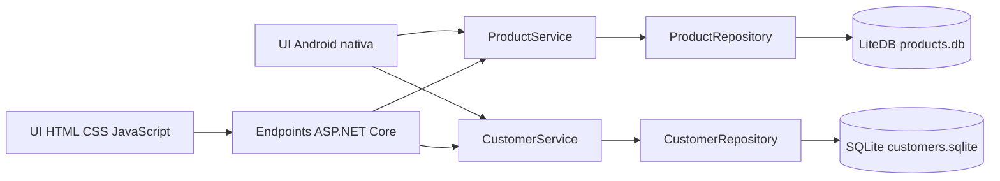

# EasyShop

Aplicação acadêmica para cadastro e listagem de produtos e clientes. Produtos são documentos no **LiteDB**; clientes são registros no **SQLite**. Interface em português com preço em reais, categorias e atributos opcionais.

Também inclui **aplicativo Android nativo em C#**, com APK e bancos locais no próprio Android, sem depender do servidor Windows. Consulte [Android e emulador](docs/android.md) e a [auditoria do briefing](docs/auditoria-briefing.md).

## Interface Android e demonstração automatizada

A interface Android inclui abas de produtos e clientes, cartões, instruções de preenchimento, validação junto aos campos e preservação de rascunhos ao alternar abas. Os formulários acomodam o teclado virtual durante a digitação. Os serviços, repositórios e regras de persistência permanecem os mesmos.

Para gravar uma demonstração real no emulador, com voz em português e legendas, execute `./scripts/demonstrar-app.ps1`. A automação instala **EasyShop Demo** separadamente, preserva os dados do app original e verifica 14 comportamentos. Também é possível substituir a voz por um áudio externo e sincronizar novamente as cenas e legendas. Consulte as [instruções e dependências](docs/video/automacao.md). Vídeos, áudios e bancos ficam locais e não são versionados.

## Executar no Windows

Pré-requisitos: SDK .NET 10, navegador moderno e internet apenas para restaurar pacotes. O SDK foi instalado neste computador em `%LOCALAPPDATA%/EasyShop/dotnet`; o script encontra essa instalação ou o `dotnet` do PATH.

```powershell
./scripts/dotnet.ps1 restore EasyShop.slnx
./iniciar.ps1
```

Abra **http://127.0.0.1:5080**. Para parar, pressione Ctrl+C no terminal. Em outro computador com SDK no PATH, também funciona `dotnet run --project src/EasyShop`.

## Funcionalidades e regras

- Produtos: nome de 2 a 120 caracteres, preço positivo até R$ 999.999.999,99, máximo de duas casas decimais. No formulário, use `29,90` ou `29.90`, sem separador de milhar. A API recebe número JSON decimal.
- Até 20 categorias e 20 atributos por produto; categorias/chaves com até 60 caracteres e valores até 200. Categorias repetidas são consolidadas. No formulário, atributos são `chave: valor`, um por linha.
- Clientes: nome e sobrenome até 160 caracteres; e-mail até 254 caracteres, validado, sem nome de exibição, normalizado para minúsculas e sem espaços externos. Domínio deve conter ponto. Não há confirmação de propriedade por e-mail.
- E-mail único garantido também por restrição no banco, inclusive para cadastros concorrentes.
- Estados de carregamento, vazio, sucesso e erro. Layout responsivo; dados permanecem após fechar e reabrir.

Edição, exclusão, autenticação, sincronização e exportação estão fora desta entrega. Produtos com o mesmo nome são permitidos. O app é de uso local individual e não deve ser exposto na internet.

## Arquitetura



`src/EasyShop/wwwroot`: interface web; `Models`: entidades; `Services`: validações; `Data`: repositórios e conexões. `src/EasyShop.Android/MainActivity.cs`: interface Android nativa. O projeto Android compila os mesmos arquivos de Models, Services e Data por links de compilação, sem duplicar as regras. Dependências injetadas pelo ASP.NET Core na versão web e compostas explicitamente na Activity Android. LiteDB oferece API síncrona; no Android as operações são executadas em tarefa fora da UI. SQLite usa conexões por operação, comandos parametrizados e API assíncrona; o driver pode executar I/O de forma síncrona internamente.

## Dados locais e configuração

Por padrão: `%LOCALAPPDATA%/EasyShop/data/products.db` e `customers.sqlite`. Nenhum banco é versionado. Para isolar uma demonstração:

```powershell
./scripts/dotnet.ps1 run --project src/EasyShop -- --DataDirectory=C:/Temp/EasyShopDemo
```

Também é possível configurar a variável `DataDirectory`. Caminhos relativos são resolvidos a partir do diretório de trabalho do processo. Para backup, encerre o aplicativo e copie a pasta de dados. Os dados não são criptografados; proteja a conta do Windows e não use informações pessoais reais nas demonstrações.

## Build e testes

```powershell
./scripts/dotnet.ps1 build EasyShop.slnx -c Release
./scripts/dotnet.ps1 test EasyShop.slnx -c Release
./scripts/dotnet.ps1 format EasyShop.slnx --verify-no-changes --no-restore
./scripts/dotnet.ps1 list src/EasyShop package --include-transitive --vulnerable
```

Os testes usam pastas temporárias distintas para validações, reabertura dos bancos, normalização e duplicidade concorrente. Evidências em [docs/evidencias](docs/evidencias). O teste de interface está em `scripts/ui-smoke.cjs`: instale Playwright em uma pasta temporária, instale Chromium com a CLI e configure `NODE_PATH` para essa pasta. Execute com uma base vazia de demonstração e o app rodando na porta 5080. O script cadastra dados fictícios e gera capturas; não o execute contra dados de uso real.

## Empacotamento real

Dois alvos: servidor local ASP.NET Core para Windows x64 com UI no navegador e aplicativo nativo .NET for Android. A versão Android foi acrescentada após solicitação expressa de execução em emulador. O APK inclui x86_64 para emulador e arm64; o teste real registrado cobre Android 16/API 36 x86_64. Não houve teste em aparelho físico.

Para Android, com SDK Android, JDK e workload `android` instalados:

```powershell
./scripts/build-android.ps1
./scripts/install-android.ps1
```

O primeiro comando gera `artifacts/android/br.edu.easyshop-Signed.apk`; o segundo instala e abre no único emulador conectado. A assinatura é de desenvolvimento, adequada à avaliação por instalação direta, não à publicação em loja. Os dados Android ficam no sandbox do app, separados dos dados Windows. A solução `EasyShop.slnx` mantém o alvo desktop/testes; o projeto Android é compilado separadamente para não obrigar usuários desktop a instalar o workload móvel.

```powershell
./scripts/dotnet.ps1 publish src/EasyShop -c Release -r win-x64 --self-contained true --output artifacts/publish/win-x64
```

Execute `EasyShop.exe` dentro dessa pasta e abra a URL local. Preserve todos os arquivos, incluindo `wwwroot` e bibliotecas nativas. A saída `artifacts` não é versionada; o executável inclui runtime e dispensa instalar o SDK na máquina de destino.

## Problemas comuns

- SDK ausente: instale [.NET 10 SDK](https://dotnet.microsoft.com/download/dotnet/10.0), reabra o terminal e execute o script.
- Scripts bloqueados: use `powershell -ExecutionPolicy Bypass -File ./iniciar.ps1` somente para executar este script inspecionado; não é preciso alterar a política global.
- Porta em uso: feche a outra instância EasyShop. O app escuta exclusivamente em `127.0.0.1:5080`.
- Falha no banco: confira permissões da pasta, espaço em disco e se outra instância mantém o LiteDB aberto. Consulte o terminal; a UI omite detalhes internos.
- Falha no restore: confira conexão e acesso a `api.nuget.org`.
- Preço inválido: digite `1299,90`, sem `R$` e sem ponto de milhar.

## Entrega e colaboração

- [Relatório executivo](docs/relatorio-executivo.md)
- [Manual do usuário](docs/manual-do-usuario.md)
- [Roteiro e checklist do vídeo](docs/video/roteiro.md)
- [Checklist e links finais](docs/entrega.md)
- [Licenças de dependências](docs/dependencias.md)

O aluno supervisiona a entrega. O colaborador grava, narra, edita e publica o vídeo de 3 a 5 minutos; seu identificador GitHub ainda precisa ser informado. Não há vídeo publicado por esta implementação. Os módulos de logística/finanças estão **não aplicáveis ao escopo EasyShop - pendentes de confirmação**. O alvo Android agora integra a entrega EasyShop.

Prazo informado no briefing: **30/11/2026**. Consulte o checklist para as pendências acadêmicas e os resultados efetivamente verificados.
