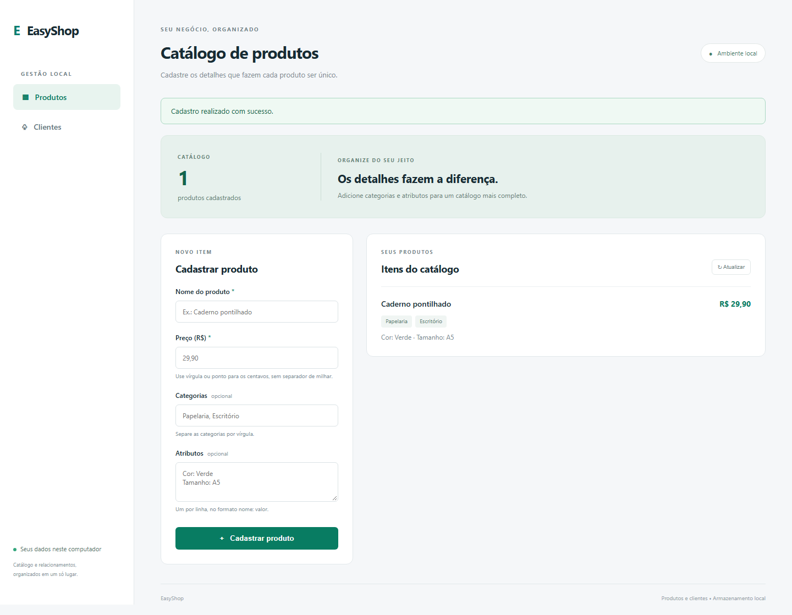
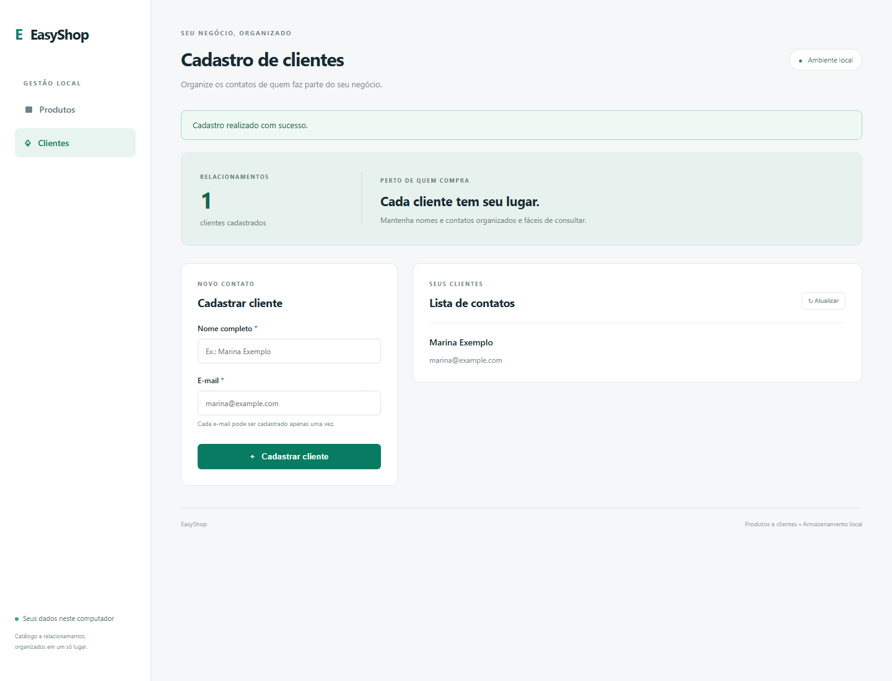
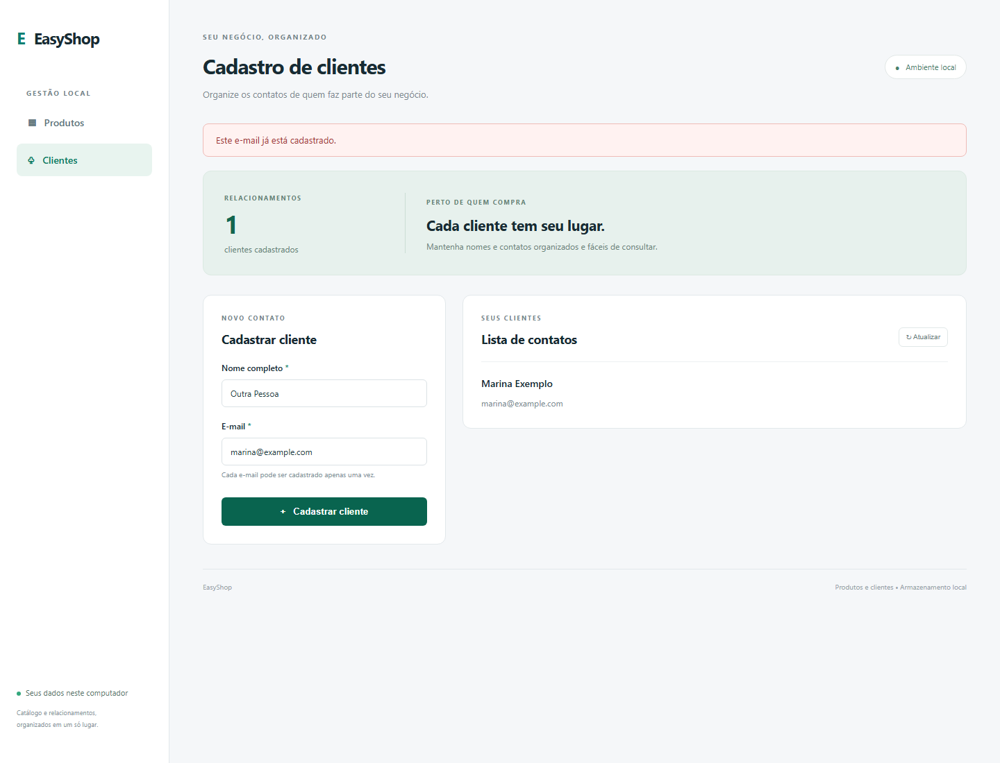

# Manual do usuário EasyShop

## Acesso e navegação

Execute `./iniciar.ps1` na raiz do projeto e abra http://127.0.0.1:5080. Mantenha o terminal aberto. Use Produtos e Clientes no menu para alternar os cadastros. No celular ou em janela estreita, o menu fica no topo; o aplicativo continua sendo executado no computador local.

## Produtos

Informe nome e preço, por exemplo Caderno pontilhado e 29,90. Categorias são opcionais, separadas por vírgula. Atributos também são opcionais: escreva `Cor: Verde` e `Tamanho: A5`, um em cada linha. Clique em Cadastrar produto. Uma mensagem confirma o cadastro, o formulário é limpo e a listagem é atualizada. O total representa a quantidade de produtos, não estoque.

## Clientes

Selecione Clientes. Informe nome e sobrenome e um e-mail válido. Clique em Cadastrar cliente. O e-mail é convertido para minúsculas; cada endereço só pode aparecer uma vez.

## Erros e recuperação

Preço zero, negativo ou com mais de duas casas decimais é rejeitado. Não use separador de milhar. Um nome de cliente sem sobrenome ou um e-mail inválido também é rejeitado. Corrija os campos e tente novamente. Se o e-mail já existir, confira a lista antes de cadastrar novamente.

Se o servidor parar, reexecute o script e use Atualizar. Em falha de armazenamento, confira o terminal e as permissões da pasta de dados. Se o cadastro foi salvo mas a atualização falhou, clique em Atualizar antes de tentar cadastrar outra vez.

## Persistência e encerramento

Feche com Ctrl+C no terminal. Os dados ficam em `%LOCALAPPDATA%/EasyShop/data`, salvo configuração de pasta alternativa. Ao executar novamente, os cadastros continuam disponíveis. Para backup, pare o app e copie a pasta completa. As capturas deste manual usam uma base isolada e dados fictícios.

O sistema não oferece edição e exclusão nesta versão. Não há login, recuperação de senha, acesso remoto nem aplicativo Android.
